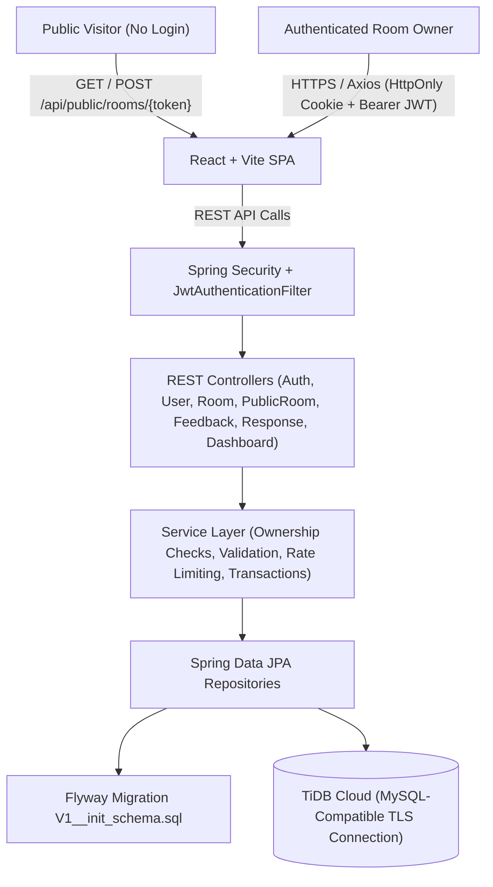
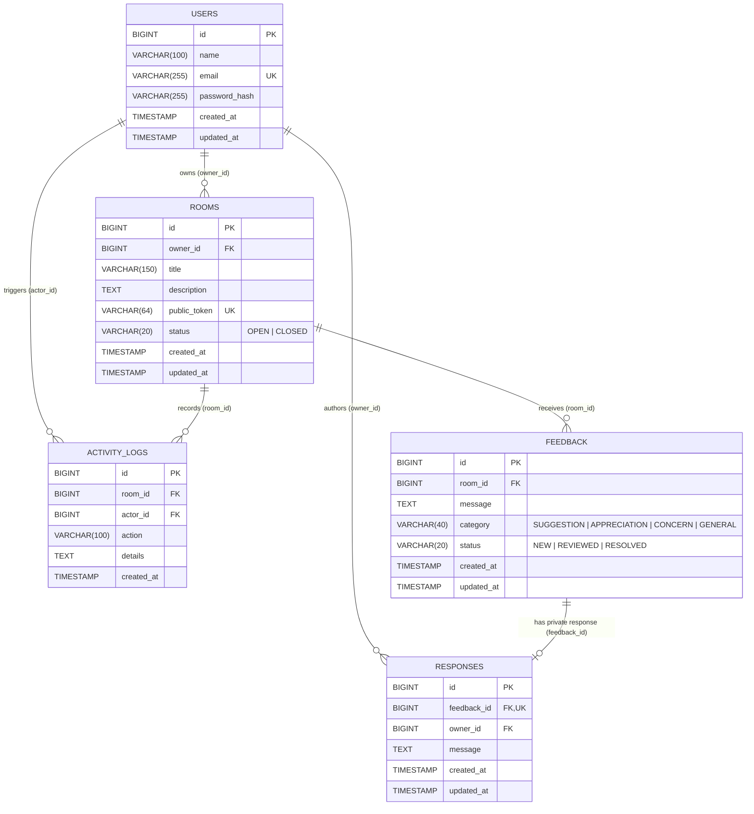

# HonestRoom — Anonymous Feedback Platform

**HonestRoom** is a full-stack anonymous feedback platform built with **React 18 + Vite**, **Java 21 + Spring Boot 3.4**, and **TiDB Cloud** (MySQL-compatible distributed SQL database).

Registered organizers can create dedicated feedback rooms and share unique, cryptographically generated public links (`/f/:token`). Anyone with a valid link can submit categorized feedback (**Suggestion**, **Appreciation**, **Concern**, or **General**) without creating an account or providing their name, email address, or tracking cookies. Room owners can triage submissions, filter and search messages, update statuses (**NEW**, **REVIEWED**, **RESOLVED**), write private owner responses, and monitor real-time statistics on their dashboard.

---

## 1. Key Features

- **Zero-Account Anonymous Submissions (`/f/:token`)**: Visitors submit feedback via an unguessable 24-character token link without signing up or entering personal details.
- **Privacy by Schema Design**: The `feedback` table stores no sender name, email, account foreign key, or IP address.
- **Abuse & Spam Controls**: Server-side in-memory sliding-window rate limiting (using ephemeral salted SHA-256 hashes), input sanitization, 5,000-character bounds, and a hidden honeypot field.
- **Full Room Lifecycle Management**: Create, edit, open/close, copy shareable links, and transactionally delete rooms and their dependent records.
- **Feedback Triage & Private Owner Responses**: Filter feedback by category and status, search by text, sort newest/oldest, paginate large lists, transition statuses (`NEW` → `REVIEWED` → `RESOLVED`), and manage private owner responses.
- **Live Owner Dashboard**: Aggregated metrics (total rooms, open rooms, total/pending/resolved feedback), recent submissions, and a 7-day activity chart powered by Recharts.
- **Security & Ownership Enforcement**: BCrypt password hashing (cost 12), stateless JWT authentication supporting both `HttpOnly` cookies (`SameSite=Lax`) and `Authorization: Bearer` headers, and strict service-layer ownership checks on every protected operation.

---

## 2. Technology Stack

| Layer | Technologies |
| :--- | :--- |
| **Frontend** | React 18, Vite 6, React Router 6, Axios, Lucide React, Recharts, CSS Custom Properties |
| **Backend** | Java 21, Spring Boot 3.4, Spring Web, Spring Data JPA, Hibernate 6, Spring Security, Bean Validation, Spring Boot Actuator, SpringDoc OpenAPI (Swagger UI) |
| **Database** | TiDB Cloud (MySQL-compatible JDBC driver `mysql-connector-j`), Flyway Schema Migrations (`V1__init_schema.sql`), H2 (MySQL compatibility mode for isolated automated tests and local fallback) |
| **Testing** | JUnit 5, Mockito, Spring Boot Test, MockMvc, Vitest, React Testing Library |

---

## 3. System Architecture



### Backend Package Structure (`com.honestroom`)

```text
com.honestroom
├── config        # SecurityConfig, OpenApiConfig
├── security      # JwtTokenProvider, JwtAuthenticationFilter, JwtAuthenticationEntryPoint, CustomUserDetails
├── controller    # AuthController, UserController, RoomController, PublicRoomController, FeedbackController, ResponseController, DashboardController
├── service       # AuthService, UserService, RoomService, FeedbackService, ResponseService, DashboardService, RateLimiterService
├── repository    # UserRepository, RoomRepository, FeedbackRepository, ResponseRepository, ActivityLogRepository
├── entity        # User, Room, RoomStatus, Feedback, FeedbackCategory, FeedbackStatus, FeedbackResponse, ActivityLog
├── dto           # Request and Response Java records with Jakarta Validation
├── exception     # GlobalExceptionHandler, ErrorResponse, ApiException hierarchy
└── util          # TokenGenerator (SecureRandom), SanitizationUtil
```

---

## 4. Database Schema & Relationships

Managed by Flyway at `backend/src/main/resources/db/migration/V1__init_schema.sql`:



### Deletion & Orphan Prevention Policy
- Deleting a room (`DELETE /api/rooms/{id}`) executes inside a `@Transactional` service method that explicitly deletes all child `responses`, `feedback`, and `activity_logs` belonging to the room before deleting the `rooms` record, backed by `ON DELETE CASCADE` foreign keys at the database level.
- Deleting a single feedback item (`DELETE /api/feedback/{id}`) transactionally removes its associated `responses` record before deleting the `feedback` record.

---

## 5. Prerequisites

- **Java**: JDK 21 or newer
- **Maven**: 3.9+
- **Node.js**: 18+ (tested with Node 24) and **npm** 9+
- **TiDB Cloud**: A TiDB Cloud Serverless or Dedicated cluster (for cloud persistence)

---

## 6. TiDB Cloud Setup & Connection Guide

1. **Create or Select a Cluster**:
   - Sign in to [TiDB Cloud Console](https://tidbcloud.com/).
   - Create a free **TiDB Serverless** cluster (or select an existing cluster).
2. **Create Database & User**:
   - In the cluster overview, click **Connect** to view your generated username prefix (e.g., `<prefix>.root`) and generate/copy your database password.
   - Open the TiDB Cloud SQL Editor (or connect via MySQL CLI) and run:
     ```sql
     CREATE DATABASE IF NOT EXISTS honestroom CHARACTER SET utf8mb4 COLLATE utf8mb4_unicode_ci;
     ```
3. **Obtain Connection Details**:
   - Copy the **Host** (e.g., `gateway01.us-west-2.prod.aws.tidbcloud.com`), **Port** (`4000`), **Username** (`<prefix>.root`), and **Password**.
4. **Configure Network Access**:
   - TiDB Serverless allows public TLS-encrypted connections (`sslMode=VERIFY_IDENTITY`) by default. If using TiDB Dedicated, add your server/workstation IP address to the IP Access List.
5. **Configure Environment Variables**:
   - Copy `backend/.env.example` and export the variables in your shell or hosting environment:
     ```powershell
     $env:TIDB_HOST="gateway01.us-west-2.prod.aws.tidbcloud.com"
     $env:TIDB_PORT="4000"
     $env:TIDB_DATABASE="honestroom"
     $env:TIDB_USERNAME="your_prefix.root"
     $env:TIDB_PASSWORD="your_tidb_password"
     $env:JWT_SECRET="replace_with_a_strong_256_bit_secret_key_at_least_32_chars"
     $env:FRONTEND_URL="http://localhost:5173"
     $env:SERVER_PORT="8080"
     ```
6. **Run Database Migrations**:
   - Flyway is enabled automatically on application startup (`spring.flyway.enabled=true`) and executes `src/main/resources/db/migration/V1__init_schema.sql`, followed by Hibernate schema validation (`spring.jpa.hibernate.ddl-auto=validate`).
7. **Test the Connection**:
   - Start the backend (`mvn spring-boot:run`) and check `/actuator/health` (`http://localhost:8080/actuator/health`), which returns `{"status":"UP"}` once the JDBC pool and Flyway migration succeed.

---

## 7. Local Setup & Running Instructions

### A. Start the Backend

**Option 1 — With TiDB Cloud credentials configured in environment variables:**
```powershell
cd backend
mvn spring-boot:run
```

**Option 2 — Local file-backed development profile (when TiDB Cloud credentials are not yet set):**
```powershell
cd backend
mvn spring-boot:run "-Dspring-boot.run.profiles=local"
```

- Backend API base URL: `http://localhost:8080/api`
- Health check endpoint: `http://localhost:8080/actuator/health`
- Interactive OpenAPI / Swagger UI: `http://localhost:8080/swagger-ui.html`

### B. Start the Frontend

```powershell
cd frontend
cp .env.example .env
npm install
npm run dev
```

- Frontend application URL: `http://localhost:5173`

---

## 8. Environment Variable Reference

### Backend (`backend/.env.example`)

| Variable | Description | Default (Dev) |
| :--- | :--- | :--- |
| `TIDB_HOST` | TiDB Cloud cluster hostname | `localhost` |
| `TIDB_PORT` | TiDB Cloud port | `4000` |
| `TIDB_DATABASE` | Target database name | `honestroom` |
| `TIDB_USERNAME` | TiDB Cloud username | `root` |
| `TIDB_PASSWORD` | TiDB Cloud password | *(empty)* |
| `TIDB_SSL_MODE` | JDBC SSL mode (`VERIFY_IDENTITY` for TiDB Cloud) | `VERIFY_IDENTITY` |
| `JWT_SECRET` | 256-bit (32+ char) secret key for signing JWTs | *(dev fallback only)* |
| `JWT_EXPIRATION_MS` | JWT validity duration in milliseconds | `86400000` (24h) |
| `COOKIE_SECURE` | Set `true` in HTTPS production deployments | `false` |
| `FRONTEND_URL` | Allowed CORS origin(s), comma-separated | `http://localhost:5173` |
| `SERVER_PORT` | HTTP server port | `8080` |

### Frontend (`frontend/.env.example`)

| Variable | Description | Default |
| :--- | :--- | :--- |
| `VITE_API_BASE_URL` | Public URL of the Spring Boot `/api` endpoint | `http://localhost:8080/api` |

---

## 9. REST API Endpoint Reference

### Authentication & Profile
| Method | Endpoint | Auth | Description |
| :--- | :--- | :--- | :--- |
| `POST` | `/api/auth/register` | Public | Register a new room owner account (`201 Created`) |
| `POST` | `/api/auth/login` | Public | Authenticate and receive `HttpOnly` cookie + JWT |
| `POST` | `/api/auth/logout` | Public | Clear `HttpOnly` JWT session cookie |
| `GET` | `/api/users/me` | Owner | Retrieve current authenticated user profile |
| `PUT` | `/api/users/me` | Owner | Update current user's display name |
| `PUT` | `/api/users/me/password` | Owner | Change password after verifying current password |

### Rooms
| Method | Endpoint | Auth | Description |
| :--- | :--- | :--- | :--- |
| `GET` | `/api/rooms?status=&search=` | Owner | List rooms owned by the authenticated user |
| `POST` | `/api/rooms` | Owner | Create a room with server-generated `publicToken` |
| `GET` | `/api/rooms/{id}` | Owner | Get room details (verifies ownership) |
| `PUT` | `/api/rooms/{id}` | Owner | Update room title, description, and status |
| `PATCH` | `/api/rooms/{id}/status` | Owner | Open (`OPEN`) or close (`CLOSED`) a room |
| `DELETE` | `/api/rooms/{id}` | Owner | Transactionally delete room and all child records |

### Public Anonymous Feedback
| Method | Endpoint | Auth | Description |
| :--- | :--- | :--- | :--- |
| `GET` | `/api/public/rooms/{token}` | Public | Lookup public room metadata (`title`, `description`, `status`) |
| `POST` | `/api/public/rooms/{token}/feedback` | Public | Submit anonymous feedback (`SUGGESTION`, `APPRECIATION`, `CONCERN`, `GENERAL`) |

### Feedback Management & Owner Responses
| Method | Endpoint | Auth | Description |
| :--- | :--- | :--- | :--- |
| `GET` | `/api/rooms/{id}/feedback` | Owner | Paginated feedback list (`page`, `size`, `status`, `category`, `search`, `sort`) |
| `GET` | `/api/rooms/{id}/feedback/stats` | Owner | Room status & category breakdown counts |
| `GET` | `/api/feedback/{id}` | Owner | Get single feedback item and private response |
| `PATCH` | `/api/feedback/{id}/status` | Owner | Update feedback status (`NEW`, `REVIEWED`, `RESOLVED`) |
| `DELETE` | `/api/feedback/{id}` | Owner | Delete feedback item and its response |
| `POST` | `/api/feedback/{id}/responses` | Owner | Create a private owner response |
| `GET` | `/api/feedback/{id}/responses` | Owner | Get responses for a feedback item |
| `PUT` | `/api/responses/{id}` | Owner | Edit an existing private owner response |
| `DELETE` | `/api/responses/{id}` | Owner | Delete a private owner response |

### Dashboard
| Method | Endpoint | Auth | Description |
| :--- | :--- | :--- | :--- |
| `GET` | `/api/dashboard/summary` | Owner | Aggregated counts, recent rooms, category breakdown, 7-day timeline |
| `GET` | `/api/dashboard/recent-feedback` | Owner | Recent feedback submissions across all owned rooms |

---

## 10. Running Automated Tests

### Backend Tests (JUnit 5 + Mockito + Spring Boot MockMvc)
Runs against an isolated in-memory H2 database in MySQL compatibility mode with Flyway migrations applied automatically:
```powershell
cd backend
mvn test
```

### Frontend Tests (Vitest + React Testing Library)
```powershell
cd frontend
npm test
```

---

## 11. Security & Privacy Notes

1. **Dual-Mode JWT Authentication**: On login/registration, the backend sets an `HttpOnly; SameSite=Lax` cookie (`honestroom_jwt`) and also returns a short-lived token in the JSON body for API clients/session memory. In production (`application-prod.yml`), `COOKIE_SECURE=true` enforces HTTPS-only cookie transmission.
2. **True Application-Layer Anonymity**: Anonymous feedback submissions do not require an account, do not set tracking cookies, and do not store sender IP addresses or user-agent strings in the database. Rate limiting hashes the transient connection address with an ephemeral in-memory random salt that is never written to disk.
3. **Honest Privacy Disclosure**: While HonestRoom stores zero identifying metadata in its database, standard internet routing and cloud load balancers process basic network connection metadata in transit. Users are reminded on the public submission page not to include self-identifying details inside their message text.

---

## 12. Production Deployment Guide

### Backend (Render / Railway / Fly.io / Container)
1. Build the executable JAR:
   ```powershell
   cd backend
   mvn clean package -DskipTests
   ```
2. Run with the `prod` profile and external environment variables:
   ```bash
   java -jar target/honestroom-backend-1.0.0.jar --spring.profiles.active=prod
   ```
3. Ensure `TIDB_HOST`, `TIDB_PORT`, `TIDB_DATABASE`, `TIDB_USERNAME`, `TIDB_PASSWORD`, `JWT_SECRET`, and `FRONTEND_URL` are configured in your hosting provider's secret store.

### Frontend (Vercel / Netlify / Cloudflare Pages)
1. Set `VITE_API_BASE_URL=https://your-backend-domain.example.com/api`.
2. Run `npm run build` inside `frontend/` and publish the `frontend/dist` folder.
3. SPA fallback routing is preconfigured via `frontend/public/_redirects` and `frontend/vercel.json`.

---

## 13. Troubleshooting

- **`Communications link failure` or TLS handshake error on startup**: Verify that `TIDB_HOST`, `TIDB_PORT=4000`, `TIDB_USERNAME`, and `TIDB_PASSWORD` are set, and that your JDK includes standard root CA certificates (`sslMode=VERIFY_IDENTITY`). For local offline testing without TiDB Cloud, run with `-Dspring-boot.run.profiles=local`.
- **CORS errors in browser**: Ensure `FRONTEND_URL` on the backend matches the exact origin of the Vite dev server (`http://localhost:5173`).
- **`429 Too Many Requests` when testing public feedback**: The rate limiter allows 10 submissions per minute per room token. Wait 60 seconds or adjust `PUBLIC_FEEDBACK_RATE_LIMIT` in development.
